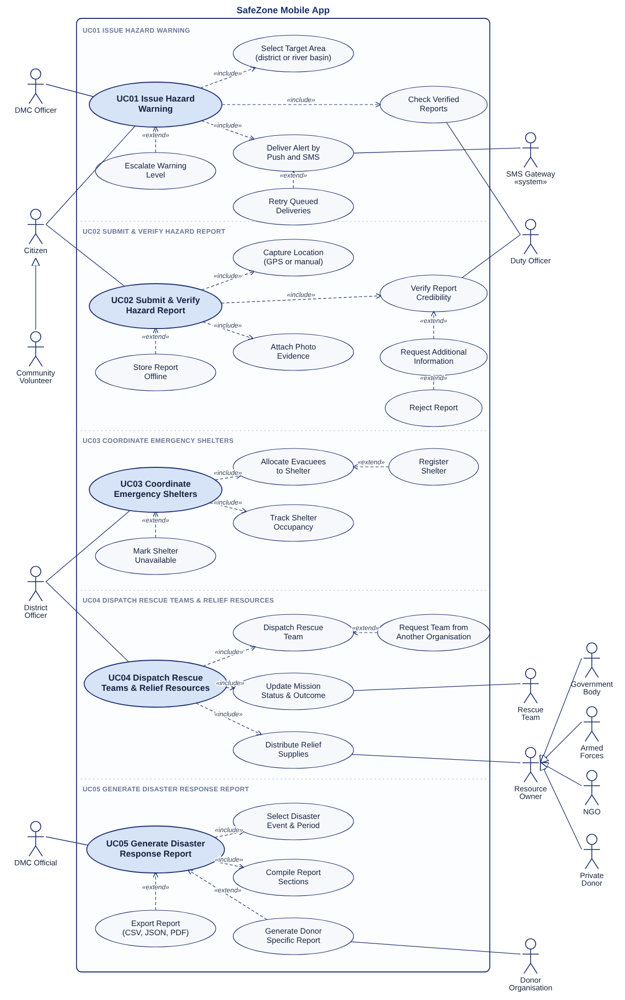
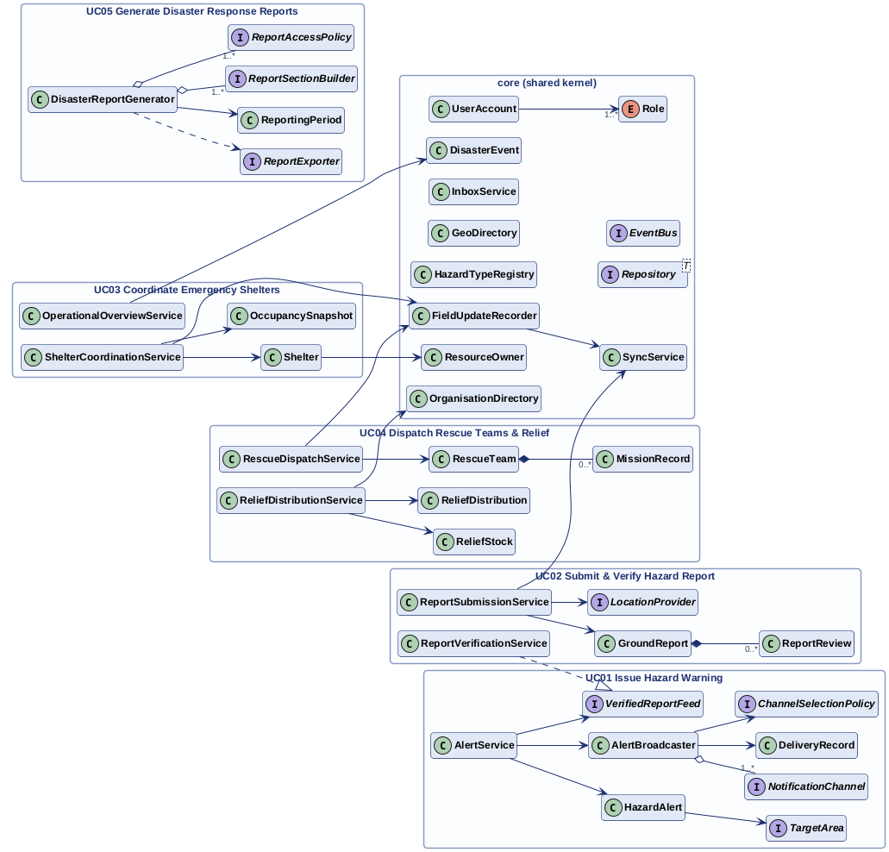

# Improved design diagrams

These diagrams describe the design **as implemented** in this repository. Each one has an
editable source next to it: PlantUML (`.puml`) for the class and sequence diagrams, and SVG for
the use case diagram. To regenerate the images, run PlantUML on the `.puml` files
(`java -jar plantuml.jar -tpng -tsvg docs/diagrams/*.puml`).

The change IDs (S1, O2, U4 …) refer to [`DESIGN_CHANGES.md`](DESIGN_CHANGES.md).

## Use case diagram

Source: [`diagrams/use-case-diagram.svg`](diagrams/use-case-diagram.svg)

## Consolidated class diagram

Source: [`diagrams/class-overview.puml`](diagrams/class-overview.puml)

## Per use case

| Use case | Class diagram | Sequence diagram |
|---|---|---|
| UC01 Issue Hazard Warning | [png](diagrams/class-uc01.png) · [puml](diagrams/class-uc01.puml) | [png](diagrams/sequence-uc01.png) · [puml](diagrams/sequence-uc01.puml) |
| UC02 Submit & Verify Hazard Report | [png](diagrams/class-uc02.png) · [puml](diagrams/class-uc02.puml) | [png](diagrams/sequence-uc02.png) · [puml](diagrams/sequence-uc02.puml) |
| UC03 Coordinate Emergency Shelters | [png](diagrams/class-uc03.png) · [puml](diagrams/class-uc03.puml) | [png](diagrams/sequence-uc03.png) · [puml](diagrams/sequence-uc03.puml) |
| UC04 Dispatch Rescue Teams & Relief Resources | [png](diagrams/class-uc04.png) · [puml](diagrams/class-uc04.puml) | [png](diagrams/sequence-uc04.png) · [puml](diagrams/sequence-uc04.puml) |
| UC05 Generate Disaster Response Reports | [png](diagrams/class-uc05.png) · [puml](diagrams/class-uc05.puml) | [png](diagrams/sequence-uc05.png) · [puml](diagrams/sequence-uc05.puml) |
